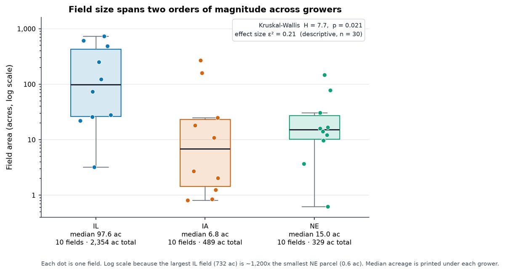
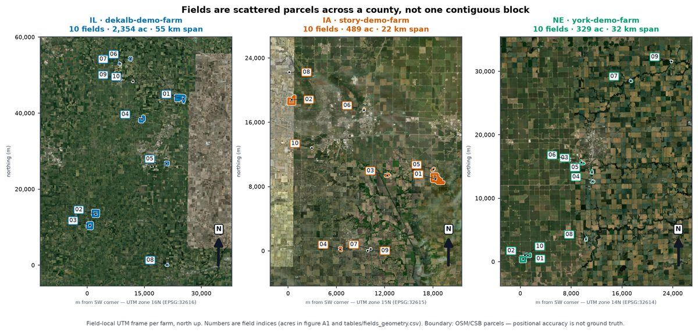
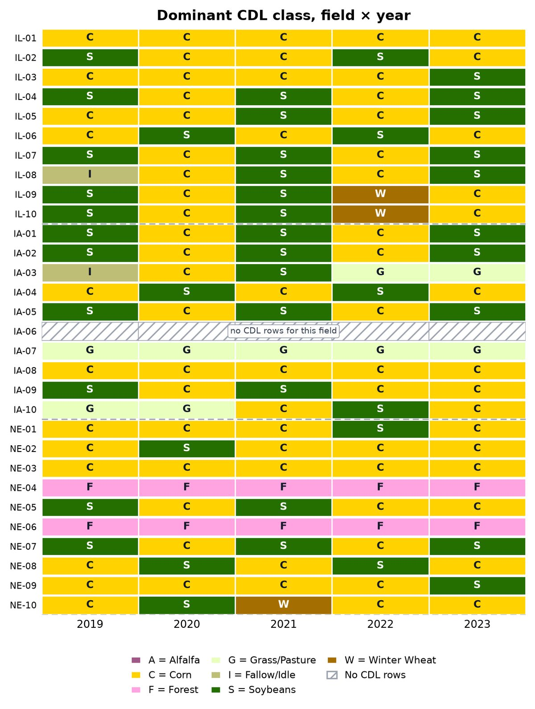
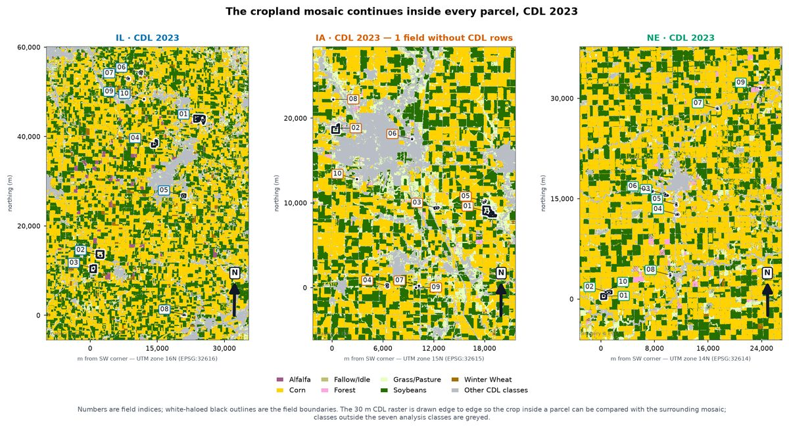
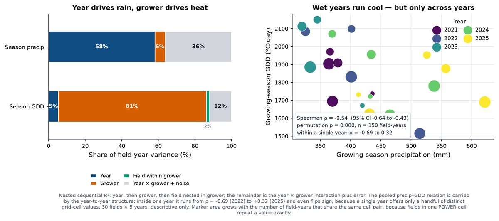
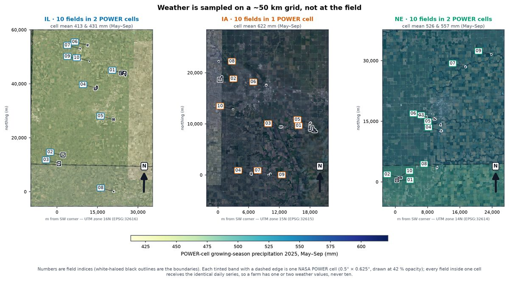

# Field-level EDA — three demo growers (Illinois, Iowa, Nebraska)

One-time report assembled from the `eda-field-comparison` workflow. The
workflow itself writes figures, tables, `comparisons.json` and
`manifest.json`; this document is the follow-up assembly step, kept here as a
worked example of what `manifest.json` supports.

| | |
|---|---|
| Scope | 3 growers × 10 fields = **30 fields**, **150 field-years** |
| Layers | field boundaries, USDA CDL (2019–2023), NASA POWER daily weather (2021–2025) |
| Not used | soil, imagery indices, yield, management records |
| Workflow | `my-farm-advisor/eda/eda-field-comparison/` |
| Source run | `$DATA_PIPELINE_DATA_ROOT/data-pipeline/eda/assignment-2-field-eda/` |

Three questions organise everything below: does a field change over time, how
do the fields of one grower differ, and what is genuinely different between
growers rather than just weather.

## Comparison levels

| Level | Meaning | Examples |
|---|---|---|
| `field` | one row per field | area, shape, five-year mean crop mix |
| `field-year` | one row per field per year | CDL class per year, seasonal rain and heat |
| `grower` | fields of one grower compared | GDD curves inside one farm |
| `across-grower` | growers compared with each other | area distributions, rotation counts |

With three growers and ten fields each, every p-value below is descriptive.
Nothing here is a population test.

## A. Geometry — where the acres are



| Grower | Fields | Total acres | Median field | Smallest | Largest | Farm span |
|---|---|---|---|---|---|---|
| IL | 10 | 2,354 | 97.6 ac | 3.2 ac | 732 ac | 55 km |
| IA | 10 | 489 | 6.8 ac | 0.8 ac | 270 ac | 22 km |
| NE | 10 | 329 | 15.0 ac | 0.6 ac | 148 ac | 32 km |

Field size spans roughly 1,200× end to end (732 ac vs 0.62 ac). Kruskal–Wallis
across growers: H = 7.7, p = 0.021, ε² = 0.21. After Holm correction only
IL–IA separates (p = 0.042); IL–NE sits at p = 0.062 and IA–NE at p = 0.57, so
the honest reading is "IL runs much bigger parcels", not "three distinct size
classes".



No grower farms one contiguous block: each "farm" is ten parcels scattered
across a county, 22–55 km from edge to edge. That matters for anything
weather-driven — no single on-farm weather station would represent a farm.

Shape tells a different story than size (figure A2, not reproduced here):
compactness **falls** with area (Spearman ρ = −0.48, 95 % CI −0.73 to −0.12,
permutation p = 0.009). The 250–730 ac parcels score 0.16–0.25 on the
Polsby–Popper index because they are long bottomland tracts or perforated
tracts; sub-10-acre parcels are mostly simple rectangles. Shape is not a proxy
for sensing quality: a sub-acre field is weak because it is only a few 30 m
pixels wide, which is a resolution problem, not a shape problem.

## B. Land cover — rotation is a field property



Share of classified field area, averaged over 2019–2023: corn 43.4 %,
soybeans 34.8 %, forest 7.5 %, grass/pasture 7.2 %, winter wheat 4.0 %,
fallow/idle 2.8 %, alfalfa 0.4 %.

The five-year means hide the interesting part. Nineteen of 29 CDL-covered
fields change dominant class at least three times in four transitions, and
**twelve change every single year** (clean corn–soy alternation). Six never
change at all: `IL-01` (continuous corn), `IA-08` (continuous corn), `NE-03`
(continuous corn), `IA-07` (grass), `NE-04` and `NE-06` (forest). Continuous
corn and stable forest sit in the same farm, which is why an average crop mix
is a poor descriptor.

Rotation counts by grower (median transitions of four): IL 4, IA 3, NE 2 —
Kruskal–Wallis H = 3.7, p = 0.16, ε² = 0.06. Diversity against parcel size:
ρ = −0.10, p = 0.59. Neither a grower effect nor a size trend is supported;
rotation behaves as a field-level management decision.



CDL classifies 25 of 29 fields at 95 % or better. The four gaps are the
smallest parcels (0.6–17 ac), where mixed edge pixels dominate — `NE-10`
(0.62 ac) reaches only 67 %. Across all fields the size relation is weak
(ρ = −0.09, p = 0.64), so "small fields classify badly" is a statement about
the four smallest, not a trend. Within a field, coverage moves less than
2 percentage points over five years for 26 of 29 fields: the gaps are edges,
not annual land-cover change. The exception is `IA-03`, which goes 62 → 97 %
as it leaves fallow.

`IA-06` carries no CDL rows at all; it is drawn as an explicit blank, and all
CDL analyses run on 29 fields.

## C. Weather — rain follows the year, heat follows the grower



Sequential nested decomposition of 150 field-years (year → grower → field
within grower → residual):

| Component | Season precipitation | Season GDD |
|---|---|---|
| Year | **58 %** | 5 % |
| Grower | 6 % | **81 %** |
| Field within grower | 0.04 % | 2 % |
| Year × grower + noise | 36 % | 12 % |

Two different structures. Rainfall is dominated by the season: a grower's
median season swings 144–288 mm between its driest and wettest year, while
grower medians differ by only ~50 mm (IL 431, IA 401, NE 379 mm;
Kruskal–Wallis p = 0.014, ε² = 0.04, and only IL–NE separates after Holm at
p = 0.0075). Heat is dominated by location: NE accumulates the most
growing-degree days in every year of the window (1,907–2,127 vs IL 1,527–1,699).

Field-within-grower is 0.04 % for rain and 2 % for GDD. That is not
microclimate — it is the sampling grid. Each field inherits the NASA POWER
0.5° × 0.625° cell containing its centroid, so IL and NE fields split across
two cells and IA fields share one.



The pooled precipitation–GDD correlation (ρ = −0.54, 95 % CI −0.64 to −0.43)
is real but is a between-year relationship: wet seasons run cool. Inside a
single year the same correlation is unstable and even flips sign.

| Year | Spearman ρ (precip vs GDD) | permutation p |
|---|---|---|
| 2021 | −0.02 | 0.93 |
| 2022 | −0.69 | < 0.001 |
| 2023 | −0.67 | < 0.001 |
| 2024 | −0.48 | 0.01 |
| 2025 | +0.32 | 0.07 |

With only a handful of distinct grid-cell values per year, this is a warning
about pooled correlations on gridded weather, not a finding about any field.

## What this supports, and what it does not

- Supported: field size and shape differ sharply between the demo growers;
  crop rotation is field-specific; rain is a year signal and heat is a
  location signal at this scale.
- Not supported: any grower ranking in yield, management quality, or
  productivity; any within-field weather variation; any causal claim about
  rotation and size.
- Boundaries are OSM/CSB parcels, not survey-grade. CDL is 30 m and annual.
  NASA POWER is a ~50 km grid. Three growers is a demonstration, not a sample.

## Reproducing this report

```bash
DATA_PIPELINE_DATA_ROOT=$HOME/my-farm-advisor-runtime \
  $HOME/my-farm-advisor-runtime/data-pipeline/.venv/bin/python \
  my-farm-advisor/eda/eda-field-comparison/src/run_field_eda.py \
  --output-dir $HOME/my-farm-advisor-runtime/data-pipeline/eda/assignment-2-field-eda
```

The run writes twelve figures, six tables, `comparisons.json` (every statistic
quoted above) and `manifest.json` (title, story, caveat and comparison levels
per figure). This report reuses six of the twelve figures at reduced size; the
full-resolution set stays in the run directory and is not committed.
