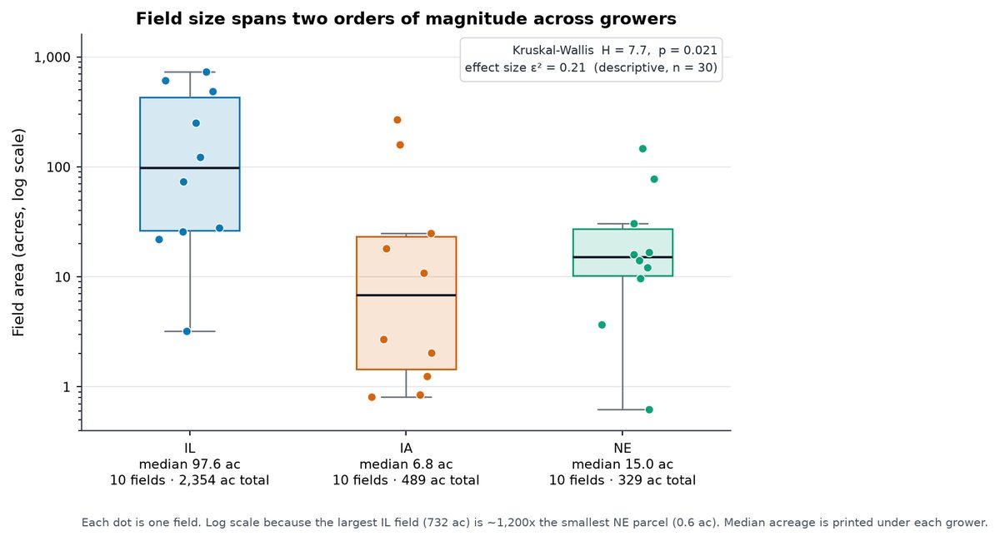
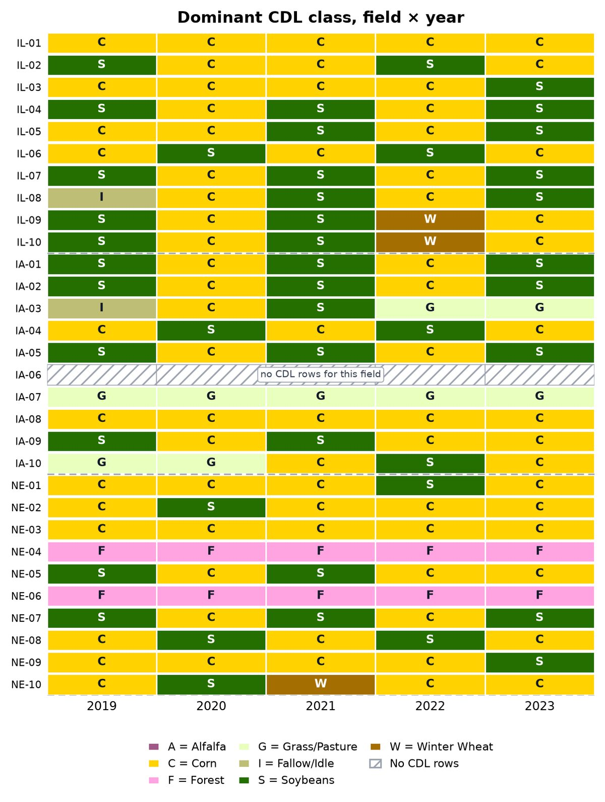
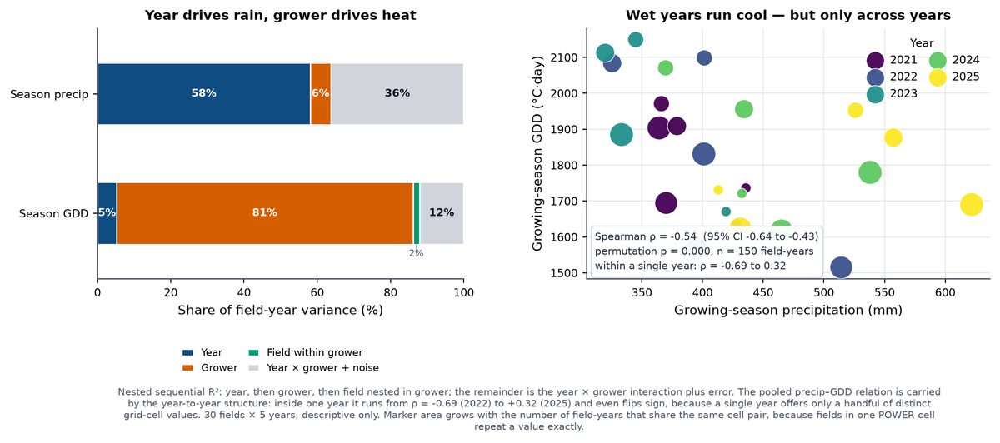

# Field EDA — short report

Thirty fields, three growers, three data layers: boundaries, USDA CDL 2019–2023,
NASA POWER weather 2021–2025. No soil, no imagery, no yield. Every number below
is copied from `comparisons.json` in the run directory; with three growers each
p-value is descriptive.

## 1. The farms differ mainly in parcel size

| Grower | Fields | Total | Median field | Largest |
|---|---|---|---|---|
| IL | 10 | 2,354 ac | 97.6 ac | 732 ac |
| IA | 10 | 489 ac | 6.8 ac | 270 ac |
| NE | 10 | 329 ac | 15.0 ac | 148 ac |

Field size spans ~1,200× (732 ac down to 0.6 ac); Kruskal–Wallis H = 7.7,
p = 0.021, ε² = 0.21. After Holm correction only IL–IA separates (p = 0.042), so
the finding is "IL runs much bigger parcels", not three distinct size classes.
Shape is not a size proxy in the useful direction: compactness **falls** with area
(ρ = −0.48, CI −0.73…−0.12, p = 0.009) because the largest tracts are long or
perforated.

## 2. Land use is a field property, not a grower one

Corn (43 %) and soybeans (35 %) dominate the classified area; forest, grass and
wheat make up the rest. The five-year mean hides the pattern that matters:
12 of 29 classified fields change dominant class every year, 6 never change at
all (continuous corn in IL, IA and NE; grass in IA-07; forest in NE-04, NE-06).

Rotation counts differ by grower in the raw medians (IL 4, IA 3, NE 2) but not
significantly (H = 3.7, p = 0.16, ε² = 0.06), and rotation diversity has no
relation to parcel size (ρ = −0.10, p = 0.59). Rotation behaves like a
per-field decision.

Classification quality is good where it matters: 25 of 29 fields sit at 95 %+
median coverage and 26 of 29 move less than 2 percentage points across five
years. The gaps are the smallest parcels (`NE-10`, 0.67 ac, 67 %) — an edge-pixel
effect, not land-cover change. `IA-03` is the one real move: 62 → 97 % as it
leaves fallow. `IA-06` has no CDL rows at all and is excluded from CDL analyses.

## 3. Rain follows the year, heat follows the grower

| Share of variance | Precipitation | GDD |
|---|---|---|
| Year | **58 %** | 5 % |
| Grower | 6 % | **81 %** |
| Field within grower | 0.04 % | 2 % |
| Year × grower + noise | 36 % | 12 % |

Two different structures: rainfall is a season signal (a grower's median swings
144–288 mm between years, while grower medians differ by ~50 mm), heat is a
location signal (NE leads every year, 1,907–2,127 GDD vs IL 1,527–1,699).

Field-within-grower is ~0 % for rain and 2 % for GDD — that is not microclimate,
it is the NASA POWER grid. Each field inherits the 0.5° × 0.625° cell holding its
centroid: IL and NE fields split across two cells, IA fields share one.

The pooled precipitation–GDD correlation (ρ = −0.54, CI −0.64…−0.43) is a
**between-year** artefact. Within a single year it is unstable and flips sign:
2022 −0.69, 2023 −0.67, 2024 −0.48, 2021 −0.02, 2025 +0.32. Do not read a
pooled correlation on gridded weather as a field-level relationship.

## Takeaway

- Supported: parcels differ sharply in size and shape; crop rotation is
  field-specific; rain is a year signal, heat a location signal at this scale.
- Not supported: any grower ranking on productivity or management, any
  within-field weather variation, any causal claim linking rotation and size.
- Resolution limits: parcels are OSM/CSB, not survey-grade; CDL is 30 m annual;
  weather is a ~50 km grid. Three growers is a demonstration, not a sample.

Full version with all twelve figures: [`field-eda-report.md`](field-eda-report.md).
Reproduce the inputs with `src/run_field_eda.py` (see
[`GUIDE.md`](../../GUIDE.md)).
